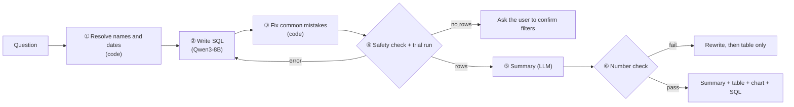

# Sprout Data Assistant: a Text-to-SQL agent for questions in Chinese

English | [繁體中文](README.zh-TW.md)

> ⚠️ Demo project. "Sprout Tech" (星芽科技) is a fictional company. Every app, country, ad campaign and number in the database is synthetic, generated by `scripts/make_fake_db.py`.

Operations staff ask about their metrics in plain Chinese, for example "revenue per app last month" or "CPI of our TikTok ads". The agent writes the SQL, **runs it before answering**, and replies with a short summary, a table, a chart and the exact SQL it ran, so anyone can check the result.

Everything runs locally: Ollama (Qwen3-8B) for the model, SQLite for the data, Streamlit for the chat UI.


## How it works

1. **Code resolves names and dates first.** "記帳" (the bookkeeping app) becomes app code SPN, "抖音" becomes TikTok, "last month" becomes an exact date range. These lookups come from the database, so the model never has to guess them.
2. **The model writes the SQL.** It can also ask a clarifying question, or refuse a request to change data.
3. **Code fixes common mistakes.** For example, ratios are rewritten to divide as decimals, because SQLite integer division turns ratios such as click-through rate into 0%.
4. **Safety check, then a trial run.** Only read queries are allowed, the connection is read-only, and queries time out after 5 seconds. On an error, the error message goes back to the model for a rewrite. If the query returns nothing, the agent asks the user to confirm the filters instead of answering "0".
5. **The model writes a summary, and code checks its numbers.** Every number in the summary must appear in the query result. If it doesn't, the summary is rewritten once, and after that the agent shows only the table.



## How I know the answers are right

There are two question sets. Grading compares the result of running the SQL, not the SQL text:

- **Tuning set (28 questions):** I could see the failures while improving the agent, like practice questions.
- **Hidden set (17 questions):** never looked at while improving, only used to check whether a change really helped, like the real exam.

The model itself was never retrained. Only the prompts, examples and code changed. Current scores:

<!-- EVAL:START -->
<!-- Generated by scripts/run_eval.py. Do not edit by hand. -->
**Latest eval** (version `v2b`, model `qwen3:8b`; [how to read these scores](docs/evaluation.md#分數怎麼看), in Chinese)

- Tuning set: **27/28** (96.4%), 3.5 s per question, 2026-10-22, CI minimum 26
- Hidden set: **17/17** (100%), 3.3 s per question, 2026-10-22, CI minimum 16
<!-- EVAL:END -->

Compared with the first version, the tuning set went from 19/28 to 27/28 and the hidden set from 14/17 to 17/17. Answer time barely changed (about 3.5 s per question), because most fixes were code, not extra model calls.

What I should be upfront about:

- One tuning question still fails: "average daily DAU in Southeast Asia last month". The model groups by the wrong columns and the answer comes out about 4x too small. Adding a rule to the prompt did not fix it.
- The 17/17 on the hidden set includes one grading fix. On one question the model used a short-link code instead of the campaign name, and the original grader marked it wrong. I only found this by looking at hidden-set results, so that score is a little optimistic.
- Rerunning the same question can change the result by about one question, and the sets are small, so treat the scores as a guide, not a benchmark.

Each improvement round is written up in [docs/harness.md](docs/harness.md) (in Chinese).

## Design decisions

| Problem | Fix |
|---|---|
| The model guesses codes and dates ("記帳" written as 'Accounting') | Code looks up the real codes in the database and turns relative dates into exact ranges before the model sees the question |
| The model adds "today" when the question has no date | The model is told: no date means the whole data period |
| Wrong SQL | Trial run first; the error goes back to the model, up to 2 retries |
| Answering "0" when nothing matches | Empty results never reach the model; the agent asks the user to confirm the filters |
| Made-up numbers in the summary | Every number in the summary must appear in the query result, otherwise it is rewritten |
| Requests to change data | Three layers: the prompt refuses, code allows a single read query only, and the database connection is read-only. Even a delete hidden inside a `WITH` query is blocked, with unit tests |
| Huge queries | 5-second timeout, at most 500 rows |
| Choosing a chart | Code decides: dates get a line chart, up to 30 categories get a bar chart, a single number gets no chart |

## Quick start

```bash
ollama pull qwen3:8b
uv sync
uv run python scripts/make_fake_db.py                 # builds data/sprout_metrics.db
uv run text2sql-ask 上個月各 App 的總營收               # CLI ("total revenue per app last month")
                                                      # "today" = last day of the fake data (2026-09-30), so "last month" is Aug 2026; override with TODAY=YYYY-MM-DD
uv run streamlit run app/streamlit_app.py             # chat UI at http://localhost:8501
uv run python -m pytest -q tests                      # tests (MCP tests need text2sql-mcp running)
uv run python scripts/check_regression.py             # regression check, same as CI, no model needed
uv run python scripts/run_eval.py                     # full local eval, updates scores and both READMEs (needs Ollama)
uv run text2sql-mcp                                   # MCP server at http://127.0.0.1:8002/mcp
```

## More docs (in Chinese)

- [Evaluation and CI](docs/evaluation.md): how grading works, what CI checks, how to read the scores
- [Improvement loop](docs/harness.md): what changed in each round and how the scores moved
- [MCP server](docs/mcp.md): tools that let other agents query the data (MCP is a standard way for AI agents to call external tools)
- [Project structure](docs/structure.md): what each folder holds

## License

[MIT](LICENSE)
