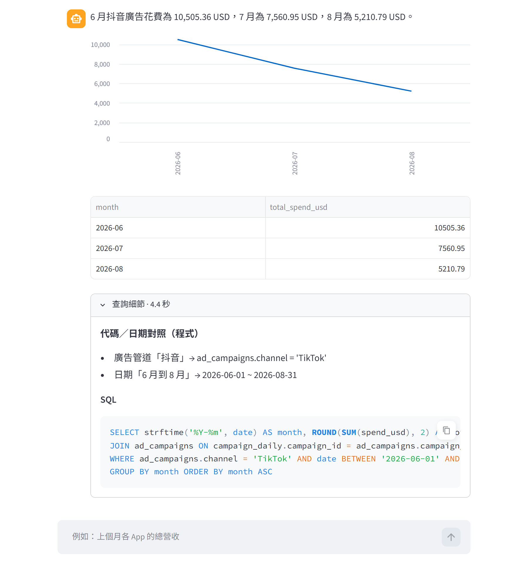
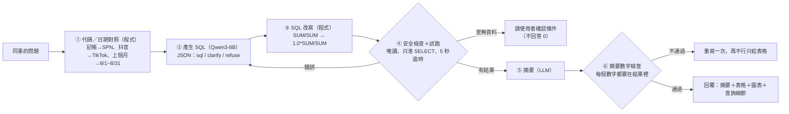

# 星芽數據小幫手：Text-to-SQL 查詢 Agent（本地 LLM × SQLite × 評測驅動改進）

> ⚠️ 示範專案：「星芽科技」是虛構公司，資料庫裡的 App、國家、廣告活動、數字全部是程式產生的假資料（`scripts/make_fake_db.py`，固定亂數種子）。

營運同事用中文問「上個月各 App 的營收」「抖音廣告的 CPI」，Agent 產生 SQL、**先試跑再回答**，回覆摘要＋表格＋圖表，並附上查詢細節（程式做的代碼對照、實際執行的 SQL）。整套跑在本機：Ollama（Qwen3-8B）、SQLite、Streamlit。



## 改善前後差異（一眼看懂）

同一個模型（Qwen3-8B，本機，沒有訓練），只改 prompt、範例和程式流程。

| 指標 | 改善前（v0：第一版） | 改善後（v2b：改進循環 3 輪） | 差異 |
|---|---|---|---|
| 調整組 28 題（改進時看得到錯題） | 19/28 | 27/28 | +8，但這組有被「針對」過 |
| 隱藏組 17 題（沒拿來調整） | 14/17 | 17/17 | +3 |
| 平均回答時間 | 3.6 秒 | 3.5 秒 | 幾乎沒變（改動多半是程式，不是多叫一次模型） |
| 參考：全程思考模式 | | 調整組 27、隱藏組 17 | 準確度一樣，每題 12～15 秒，不採用 |

**有改善的**：比率類指標（留存率、點擊率）不再因為 SQLite 整數相除變成 0%；問題沒提日期時不再自己加日期；活動名稱、版本上線日由程式對照；追問題（「那它的點擊率呢？」）沿用上一題條件。

**沒改善或要老實講的**：
- 調整組還錯 1 題：「東南亞上個月的每日平均 DAU」模型把子查詢分組寫成「每天 × 每個 App」，算出來小了約 4 倍。試過在 prompt 補規則（v3），沒用
- 隱藏組的 17/17 包含一次**評分規則修正**：「各廣告活動的 CPI」模型用短網址代碼當名稱，原本評分只收活動名稱。修正後代碼也算對（同一套規則對所有候選重評，v0 也因此 13→14）。這個修正是看了隱藏組結果才發現的，所以隱藏組的分數稍微樂觀
- 每次跑分同一題可能有 ±1 題的浮動；題目數量也不多，數字當參考，不是嚴謹的 benchmark

## 架構



## 設計重點

| 問題 | 做法 |
|---|---|
| LLM 會猜代碼（「記帳」寫成 'Accounting'）和日期 | **程式先對照**：App、國家、地區、廣告管道、平台、短網址、活動名稱、版本（附上線日）都從資料庫讀，相對日期換成明確範圍，結果以「照用」的提示交給模型（`linker.py`） |
| 問題沒提日期，模型自己加「今天」 | 對照器明講「沒有指定日期 → 查整個資料期間，不要加日期條件」 |
| SQL 寫錯 | 先試跑；錯誤訊息回饋給模型修正，最多 2 次 |
| 查無資料時回答「0」 | 結果是空的或全 NULL，不讓模型解讀，直接請使用者確認 App、國家、日期 |
| 摘要亂編數字（自己加總、算成長率） | **摘要數字檢查**：摘要裡每個數字都要在查詢結果（或問題、SQL）出現，容許四捨五入；不通過就重寫，再不通過就只給表格 |
| 被要求改資料 | 三道防線：prompt 拒答、字串檢查只准單一 SELECT/WITH、**SQLite 唯讀連線＋authorizer**（`WITH … DELETE` 這種騙過字串檢查的也擋得住，有單元測試） |
| 查詢太大拖垮資料庫 | 5 秒逾時中止、最多回傳 500 列 |
| 圖表類型 | 程式判斷：第一欄是日期 → 折線圖；30 列以內的分類 → 長條圖；單一數字不畫 |

## 評測：比對「執行結果」，不比對 SQL 字串

同一個答案有很多種 SQL 寫法，所以評分是**把標準 SQL 和模型 SQL 都執行一次，比結果**（`eval/grade.py`）：

- 列數要一樣；標準答案的每個數值欄，模型結果裡要有一欄數值相同（容許四捨五入，比率也接受 ×100 的百分比）
- 名稱欄要對得上（代碼和名稱都算：'US' = 美國、短網址 = 活動名稱）；日期欄只看列數，不管格式
- 「哪個最高」只比第一列；另外有應追問（clarify）、應拒答（refuse）、應回查無資料（empty）三種題型
- 有追問題：`before:` 先問前一題，前一題的 SQL 當作對話紀錄

`tests/test_offline.py`（不需要模型，15 題）測 SQL 安全檢查、日期對照、摘要數字檢查、整數相除改寫、圖表判斷。

## 自動改進循環（仿 Harness²，`harness/`）

跟 [policy-agent-demo](https://github.com/didiwannasleep0117/policy-agent-demo) 同一套做法：每個候選是一個資料夾（`sql_system.md`、`summary_system.md`、`fewshots.yaml`、`env.yaml` 開關、`PROPOSAL.md` 說明），`loop.py` 跑分、比較，結果和教訓寫進 `harness/EXPERIENCE.md`。只看調整組的錯題，隱藏組最後才跑。

| 候選 | 改了什麼 | 調整組 28 題 |
|---|---|---|
| v0 | 第一版 | 19 |
| v1a | Prompt：比率乘 1.0、沒提日期不加日期、JOIN 用同義欄位 | 23 |
| v1b | 程式：活動名稱／版本上線日／「到 N 月底」對照、沒提日期明講查全期間、查無資料先自檢 | 23 |
| v2a | 合併 v1a＋v1b，**程式改寫整數相除** | 27 |
| **v2b** | v2a ＋ 換範例（示範地區 JOIN、比率乘 1.0；範例題不取自調整組） | **27** |
| v3 | v2b ＋ prompt 補「每日平均只 GROUP BY date」 | 27（沒修好，淘汰） |

v2b 已複製成預設設定（`prompts/`、程式預設開關）。

**最有意思的發現**：「比率要乘 1.0」寫在 prompt 裡，8B 模型完全不理，因為它照抄範例和公式說明裡的 `SUM/SUM`。改成程式直接改寫 SQL，4 題一次修好。範例的影響力比規則文字大，所以 v2b 是換範例，不是加規則。

```bash
python harness/loop.py new v4 --from v2b          # 複製候選
python harness/loop.py probe v4 --split tune      # 跑分
python harness/loop.py fails v4                   # 看錯題（隱藏組不給看）
python harness/loop.py diff v2b v4                # 哪些修好、哪些弄壞
python harness/loop.py rescore v4 --split tune    # 評分規則修正後重評（不重跑模型）
```

## MCP 伺服器（`src/text2sql_demo/mcp_server.py`）

讓外部 Agent（n8n、Claude、Hermes…）也能查數據。`uv run text2sql-mcp` → `http://127.0.0.1:8002/mcp`（Streamable HTTP）。

| 工具 | 給誰用 | 說明 |
|---|---|---|
| `ask_metrics(question)` | 不想自己寫 SQL 的呼叫端 | 整條本地流程（對照 → 本機 8B 產生 SQL → 試跑修正 → 摘要數字檢查），回傳摘要＋SQL＋表格 |
| `describe_schema()` | 自己寫 SQL 的外部模型 | 資料表、欄位意義、指標公式、資料期間 |
| `resolve_entities(question)` | 同上 | 程式做的代碼／日期對照（跟本地流程用同一套），避免外部模型猜代碼 |
| `run_sql(sql)` | 同上 | 唯讀、只准單一 SELECT、5 秒逾時、最多 500 列；只回原始表格，不做摘要 |
| `calculate(expression)` | 所有呼叫端 | 安全計算機。成長率、差額、佔比交給它算，不要讓模型心算 |

**分工的想法**：比較強的外部模型負責「理解問題、寫 SQL、寫摘要」，容易出錯的部分交給工具：代碼對照、執行防護、計算。

⚠️ **資料敏感度**：低階工具的查詢結果會進到外部模型。示範用假資料沒問題；真實資料要先決定哪些表能給外部模型看（例如只開彙總表、不開明細和個資），敏感的問題走 `ask_metrics` 留在本機模型。

`tests/test_mcp_client.py`：伺服器有啟動時，實際用 MCP client 測工具清單、低階查詢流程、寫入被擋、計算機（共 4 題，沒啟動就跳過）。

## 快速開始

```bash
ollama pull qwen3:8b
uv sync
uv run python scripts/make_fake_db.py                 # 產生 data/sprout_metrics.db
uv run text2sql-ask 上個月各 App 的總營收               # 命令列
uv run streamlit run app/streamlit_app.py             # 聊天介面 http://localhost:8501
uv run python -m pytest -q tests                      # 測試（MCP 測試要先開 text2sql-mcp）
uv run text2sql-mcp                                   # MCP 伺服器 http://127.0.0.1:8002/mcp
```

## 目錄

```
src/text2sql_demo/
  linker.py     代碼／日期對照（程式）
  schema.py     給模型看的資料表說明、指標公式、內建範例
  agent.py      主流程：產生 SQL → 改寫 → 試跑／修正 → 摘要 → 數字檢查 → 圖表
  db.py         唯讀連線、authorizer、逾時、列數上限
  cli.py        命令列
  mcp_server.py MCP 伺服器（ask_metrics、describe_schema、resolve_entities、run_sql、calculate）
  calc.py       安全計算機
prompts/        正式版 prompt 與範例（＝改進循環選出的 v2b）
app/            Streamlit 介面
eval/           tune.yaml（28 題）、holdout.yaml（17 題）、grade.py
harness/        loop.py、candidates/、runs/、scoreboard.csv、EXPERIENCE.md
scripts/        make_fake_db.py、take_screenshots.py
tests/          離線單元測試
```
