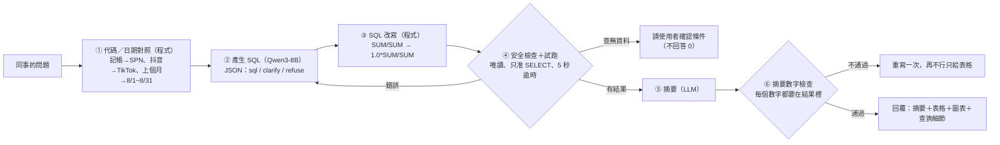

# 星芽數據小幫手：Text-to-SQL 查詢 Agent（本地 LLM × SQLite × 評測驅動改進）

> ⚠️ 示範專案：「星芽科技」是虛構公司，資料庫裡的 App、國家、廣告活動、數字全部是程式產生的假資料（`scripts/make_fake_db.py`，固定亂數種子）。

<!-- EVAL:START -->
<!-- 這段由 scripts/run_eval.py 自動產生，請不要手動修改 -->
**最新評測**：候選 `v2b`，模型 `qwen3:8b`（[怎麼看這些分數](docs/evaluation.md#分數怎麼看)）

- 調整組 tune：**27/28**（96.4%），平均 3.5 秒／題，2026-10-22，CI 基準 ≥ 26
- 隱藏組 holdout：**17/17**（100%），平均 3.3 秒／題，2026-10-22，CI 基準 ≥ 16
<!-- EVAL:END -->

營運同事用中文問「上個月各 App 的營收」「抖音廣告的 CPI」，Agent 產生 SQL、**先試跑再回答**，回覆摘要＋表格＋圖表，並附上查詢細節（程式做的代碼對照、實際執行的 SQL）。整套跑在本機：Ollama（Qwen3-8B）、SQLite、Streamlit。


## 改善前後差異（一眼看懂）

同一個模型（Qwen3-8B，本機，沒有訓練），只改 prompt、範例和程式流程。

| 指標 | 改善前（v0：第一版） | 改善後（v2b：改進循環 3 輪） | 差異 |
|---|---|---|---|
| 調整組 28 題（改進時看得到錯題） | 19/28 | 27/28 | +8，但這組有被「針對」過 |
| 隱藏組 17 題（沒拿來調整） | 14/17 | 17/17 | +3 |
| 平均回答時間 | 3.6 秒 | 3.5 秒 | 幾乎沒變（改動多半是程式，不是多叫一次模型） |
| 參考：全程思考模式 | | 調整組 27、隱藏組 17 | 準確度一樣，每題 12～15 秒，不採用 |

**有改善的**：比率類指標（留存率、點擊率）不再因為 SQLite 整數相除變成 0%；問題沒提日期時不再自己加日期；活動名稱、版本上線日由程式對照；追問題（「那它的點擊率呢？」）沿用上一題條件。

**沒改善或要老實講的**：
- 調整組還錯 1 題：「東南亞上個月的每日平均 DAU」模型把子查詢分組寫成「每天 × 每個 App」，算出來小了約 4 倍。試過在 prompt 補規則（v3），沒用
- 隱藏組的 17/17 包含一次**評分規則修正**：「各廣告活動的 CPI」模型用短網址代碼當名稱，原本評分只收活動名稱。修正後代碼也算對（同一套規則對所有候選重評，v0 也因此 13→14）。這個修正是看了隱藏組結果才發現的，所以隱藏組的分數稍微樂觀
- 每次跑分同一題可能有 ±1 題的浮動；題目數量也不多，數字當參考，不是嚴謹的 benchmark

## 架構



## 設計重點

| 問題 | 做法 |
|---|---|
| LLM 會猜代碼（「記帳」寫成 'Accounting'）和日期 | **程式先對照**：App、國家、地區、廣告管道、平台、短網址、活動名稱、版本（附上線日）都從資料庫讀，相對日期換成明確範圍，結果以「照用」的提示交給模型（`linker.py`） |
| 問題沒提日期，模型自己加「今天」 | 對照器明講「沒有指定日期 → 查整個資料期間，不要加日期條件」 |
| SQL 寫錯 | 先試跑；錯誤訊息回饋給模型修正，最多 2 次 |
| 查無資料時回答「0」 | 結果是空的或全 NULL，不讓模型解讀，直接請使用者確認 App、國家、日期 |
| 摘要亂編數字（自己加總、算成長率） | **摘要數字檢查**：摘要裡每個數字都要在查詢結果（或問題、SQL）出現，容許四捨五入；不通過就重寫，再不通過就只給表格 |
| 被要求改資料 | 三道防線：prompt 拒答、字串檢查只准單一 SELECT/WITH、**SQLite 唯讀連線＋authorizer**（`WITH … DELETE` 這種騙過字串檢查的也擋得住，有單元測試） |
| 查詢太大拖垮資料庫 | 5 秒逾時中止、最多回傳 500 列 |
| 圖表類型 | 程式判斷：第一欄是日期 → 折線圖；30 列以內的分類 → 長條圖；單一數字不畫 |

## 快速開始

```bash
ollama pull qwen3:8b
uv sync
uv run python scripts/make_fake_db.py                 # 產生 data/sprout_metrics.db
uv run text2sql-ask 上個月各 App 的總營收               # 命令列
uv run streamlit run app/streamlit_app.py             # 聊天介面 http://localhost:8501
uv run python -m pytest -q tests                      # 測試（MCP 測試要先開 text2sql-mcp）
uv run python scripts/check_regression.py             # 回歸檢查（CI 也跑這個，不需要模型）
uv run python scripts/run_eval.py                     # 本機完整評測，更新分數和 README（要開 Ollama）
uv run text2sql-mcp                                   # MCP 伺服器 http://127.0.0.1:8002/mcp
```

## 文件導覽

- [評測與 CI](docs/evaluation.md)：評分方式（比對執行結果）、CI 檢查什麼、本機怎麼跑評測、分數怎麼看
- [自動改進循環](docs/harness.md)：每個候選改了什麼、分數變化、最有意思的發現
- [MCP 伺服器](docs/mcp.md)：讓外部 Agent 查數據的工具、分工想法、資料敏感度
- [目錄結構](docs/structure.md)：每個資料夾和主要檔案的用途
