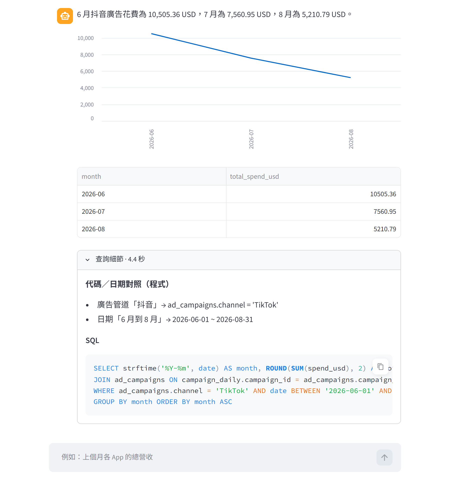
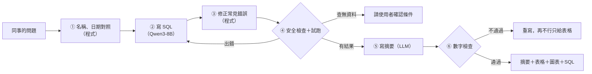

# 星芽數據小幫手：用中文問數據的 Text-to-SQL Agent

[English](README.md) | 繁體中文

> ⚠️ 示範專案：「星芽科技」是虛構公司，資料庫裡的 App、國家、廣告活動和數字，全部是程式產生的假資料（`scripts/make_fake_db.py`）。

營運同事可以直接用中文問數據，例如「上個月各 App 的營收」「抖音廣告的 CPI」。Agent 會自己寫 SQL、**先試跑確認沒問題再回答**，回覆一段摘要，加上表格和圖表，也附上實際執行的 SQL，方便核對。

整套系統都在本機執行：模型用 Ollama（Qwen3-8B），資料庫用 SQLite，聊天介面用 Streamlit。



## 它怎麼運作

1. **程式先翻譯問題裡的名稱和日期**：例如「記帳」換成 App 代碼 SPN、「抖音」換成 TikTok、「上個月」換成明確的日期範圍。這些交給程式查資料庫，不讓模型猜
2. **模型寫 SQL**：問題不清楚時會反問，要求改資料時會拒絕
3. **程式修正常見錯誤**：例如比率計算改成小數相除，避免 SQLite 整數相除算出 0%
4. **安全檢查後試跑**：只允許查詢、資料庫唯讀、5 秒逾時。出錯就把錯誤訊息交給模型重寫；查不到資料就請使用者確認條件，不會回答「0」
5. **模型寫摘要，程式檢查數字**：摘要裡的每個數字都必須出現在查詢結果裡，不通過就重寫，還是不行就只給表格



## 怎麼知道它答得對

我準備了兩種考題，評分方式是比對 SQL 執行出來的結果，不是比對 SQL 字串：

- **調整組（28 題）**：改進 Agent 時可以看錯在哪裡，像練習題
- **隱藏組（17 題）**：改進時不看題目，只拿來檢查有沒有真的變好，像正式考試

模型本身沒有重新訓練，只改 prompt、範例和程式流程。目前的分數：

<!-- EVAL:START -->
<!-- 這段由 scripts/run_eval.py 自動產生，請不要手動修改 -->
**最新評測**（版本 `v2b`，模型 `qwen3:8b`，[怎麼看這些分數](docs/evaluation.md#分數怎麼看)）

- 調整組：**27/28**（96.4%），平均每題 3.5 秒，2026-10-22，CI 最低要求 26 題
- 隱藏組：**17/17**（100%），平均每題 3.3 秒，2026-10-22，CI 最低要求 16 題
<!-- EVAL:END -->

和最初的版本相比，調整組從 19/28 進步到 27/28，隱藏組從 14/17 進步到 17/17，回答速度幾乎沒變（每題約 3.5 秒），因為大部分改動是程式，沒有多叫一次模型。

需要老實說明的地方：

- 調整組還錯 1 題：「東南亞上個月的每日平均 DAU」，模型把分組寫錯，算出來小了約 4 倍。試過在 prompt 補規則，沒有用
- 隱藏組的 17/17 包含一次評分規則修正：有一題模型用短網址代碼代替活動名稱，原本評分算錯，修正後才算對。這是看了隱藏組結果才發現的，所以這個分數稍微樂觀
- 同一題重跑，結果可能差一題左右；題目也不多，分數當參考就好

每一輪改了什麼，寫在 [docs/harness.md](docs/harness.md)。

## 設計重點

| 遇到的問題 | 怎麼解決 |
|---|---|
| 模型會猜代碼和日期（把「記帳」寫成 'Accounting'） | 程式先從資料庫查出正確的代碼，把相對日期換成明確範圍，再交給模型 |
| 問題沒提日期，模型自己加「今天」 | 明確告訴模型：沒指定日期就查整個資料期間 |
| SQL 寫錯 | 先試跑，把錯誤訊息交給模型修正，最多 2 次 |
| 查不到資料時回答「0」 | 結果是空的就不讓模型解讀，直接請使用者確認條件 |
| 摘要亂編數字 | 摘要裡每個數字都要出現在查詢結果裡，不通過就重寫 |
| 被要求改資料 | 三道防線：prompt 拒絕、程式只允許單一查詢、資料庫唯讀。連偽裝成查詢的刪除語法也擋得住，有單元測試 |
| 查詢太大拖垮資料庫 | 5 秒逾時，最多回傳 500 列 |
| 圖表怎麼畫 | 程式判斷：日期用折線圖，30 類以內用長條圖，單一數字不畫 |

## 快速開始

```bash
ollama pull qwen3:8b
uv sync
uv run python scripts/make_fake_db.py                 # 產生 data/sprout_metrics.db
uv run text2sql-ask 上個月各 App 的總營收               # 命令列
                                                      # 「今天」= 假資料最後一天（2026-09-30），所以「上個月」是 2026 年 8 月；可用 TODAY=YYYY-MM-DD 改
uv run streamlit run app/streamlit_app.py             # 聊天介面 http://localhost:8501
uv run python -m pytest -q tests                      # 測試（MCP 測試要先開 text2sql-mcp）
uv run python scripts/check_regression.py             # 回歸檢查（CI 也跑這個，不需要模型）
uv run python scripts/run_eval.py                     # 本機完整評測，更新分數和 README（要開 Ollama）
uv run text2sql-mcp                                   # MCP 伺服器 http://127.0.0.1:8002/mcp
```

## 更多文件

- [評測與 CI](docs/evaluation.md)：怎麼評分、CI 檢查什麼、分數怎麼看
- [自動改進循環](docs/harness.md)：每一輪改了什麼、分數怎麼變
- [MCP 伺服器](docs/mcp.md)：讓其他 Agent 也能查數據的工具（MCP 是讓 AI 呼叫外部工具的標準介面）
- [目錄結構](docs/structure.md)：每個資料夾放什麼

## 授權

[MIT](LICENSE)
